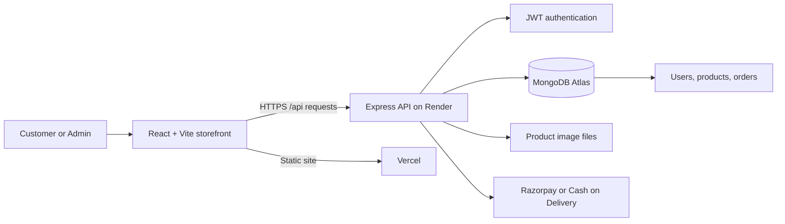
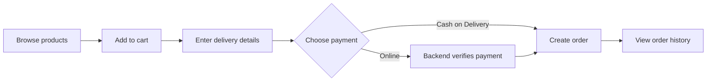

# ShopStack

ShopStack is a full-stack online store built with React, Express, and MongoDB. Customers can browse and search products, manage a cart, check out, and follow their orders. Admins can manage products and orders.

**Live store:** [shopstack-ecommerce.vercel.app](https://shopstack-ecommerce.vercel.app/)  
**API health:** [ecommerce-backend-sicp.onrender.com/api/health](https://ecommerce-backend-sicp.onrender.com/api/health)

## Features

- Product browsing, search, categories, sorting, and product details
- Customer registration, login, profile, and saved delivery details
- Persistent shopping cart and checkout with Cash on Delivery
- Demo payment mode is simulated and does not charge money
- Order history and order status updates
- Admin dashboard and product, order, and contact message management
- Product images served by the backend

## How it works



Typical shopping flow:



## Project structure

```text
E-Commerce-Website/
|-- backend/
|   |-- config/         # Database connection
|   |-- controllers/    # API request handlers
|   |-- middleware/     # Authentication and access control
|   |-- models/         # User, product, order, and contact models
|   |-- routes/         # Express API routes
|   |-- scripts/        # Maintenance scripts
|   |-- utils/          # Shared backend helpers
|   |-- server.js       # Express app and route mounts
|   `-- seed.js         # Optional product/admin seed command
|-- frontend/
|   |-- public/         # Static files and public assets
|   `-- src/
|       |-- assets/     # Frontend assets
|       |-- components/ # Shared UI components
|       |-- context/    # Authentication and cart state
|       |-- pages/      # Store, account, checkout, and admin pages
|       `-- services/   # API, payments, product, and image helpers
|-- images/             # Product images served by the backend
`-- README.md
```

## Run locally

Requirements: Node.js 20.19 or newer, npm, and a MongoDB Atlas database (or another MongoDB deployment that supports transactions).

1. Configure the backend:

   ```sh
   cd backend
   cp .env.example .env
   ```

   Set `MONGO_URI` and a long random `JWT_SECRET` in `backend/.env`. Set `CLIENT_URL=http://localhost:5173`. To create or update the admin account with the seed command, set a non-placeholder `ADMIN_PASSWORD` first.

2. Install dependencies and start the API in the `backend` directory:

   ```sh
   npm install
   npm run dev
   ```

3. In a second terminal, install and start the frontend:

   ```sh
   cd frontend
   npm install
   npm run dev
   ```

   Open the local Vite URL shown in the terminal. Vite proxies `/api` to `http://127.0.0.1:5000` by default. Set `VITE_PROXY_TARGET` in `frontend/.env` to use a different local API host.

The frontend defaults to the production API when built. To point it at another backend, set `VITE_API_URL` to either the backend origin or its `/api` URL before building.

## API overview

All API routes use the `/api` prefix. Protected routes accept `Authorization: Bearer <token>`.

| Method | Route | Access | Description |
| --- | --- | --- | --- |
| POST | `/api/auth/register` | Public | Register a customer |
| POST | `/api/auth/login` | Public | Sign in |
| GET, PUT | `/api/auth/profile` | Signed in | Read or update profile |
| GET | `/api/products` | Public | List and search products |
| GET | `/api/products/:id` | Public | Product details |
| POST, PUT, DELETE | `/api/products[/:id]` | Admin | Create, update, or delete products |
| POST | `/api/orders` | Signed in | Place a Cash on Delivery order |
| GET | `/api/orders/mine` | Signed in | View your orders |
| GET | `/api/orders/:id` | Owner or admin | View order details |
| GET | `/api/admin/dashboard` | Admin | Dashboard statistics |
| GET | `/api/admin/users` | Admin | List customers |
| GET | `/api/admin/orders` | Admin | List orders |
| PATCH | `/api/admin/orders/:id/status` | Admin | Update order status |
| GET, PATCH | `/api/admin/contact[/:id/status]` | Admin | View or update contact requests |
| POST | `/api/contact` | Public or signed in | Send a support request |
| GET | `/api/payments/config` | Public | Check online payment configuration |
| POST | `/api/payments/order` | Signed in | Create a payment session |
| POST | `/api/payments/verify` | Signed in | Verify payment |
| GET | `/api/health` | Public | Check API availability |

## Configuration and deployment

Backend settings are listed in [`backend/.env.example`](backend/.env.example). Keep `.env` files and payment secrets out of source control. Configure `CLIENT_URL` with the deployed frontend origin so the API CORS policy accepts it.

The frontend is deployed on Vercel and the Express API on Render. MongoDB Atlas stores application records. The backend serves `/product-images/*` from `frontend/public/product-images` or the repository's `images/` directory. MongoDB transactions are used for order and inventory updates, so use a replica set such as MongoDB Atlas.

Build the frontend for production from the `frontend` directory:

```sh
npm run build
```

Start the backend in production from `backend` with `npm start`.

## Data and security notes

- The seed command is optional. It refreshes the included product catalog and can create/update the admin account when configured; do not run it against a production database unless that is intended.
- Passwords are hashed, and JWTs protect signed-in and admin API routes.
- Product prices and stock are checked by the backend when orders are placed.
- Demo payment mode is for development demonstrations only. It does not move money; production payment verification uses the configured gateway.
- Never commit database credentials, JWT secrets, or payment secrets.
