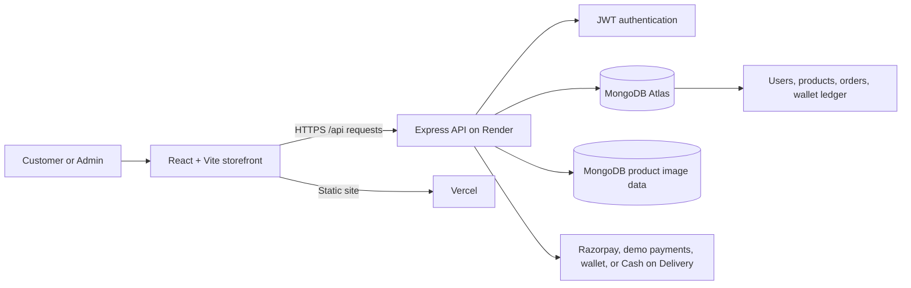
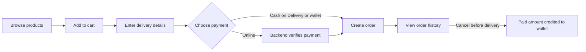

# ShopStack

ShopStack is a full-stack online store built with React, Express, and MongoDB. Customers can browse products, manage a cart, pay online or with their wallet, track or cancel orders, and request wallet withdrawals. Admins can manage products, orders, customer wallets, and withdrawals.

**Live store:** [shopstack-ecommerce.vercel.app](https://shopstack-ecommerce.vercel.app/)  
**API health:** [ecommerce-backend-sicp.onrender.com/api/health](https://ecommerce-backend-sicp.onrender.com/api/health)

## 🔐 Demo Login Credentials

Explore the website using the following demo accounts.

### 👨‍💼 Admin Login

| Field | Credentials |
|---|---|
| **Email / ID** | admin@example.com |
| **Password** | admin@2004 |
| **Role** | Administrator |

### 👤 User Login

| Field | Credentials |
|---|---|
| **Email / ID** | abc@gmail.com |
| **Password** | 12345678 |
| **Role** | Customer |

## 📝 Create a New Account

If you want to create your own account:

1. Open the website.
2. Go to the Login page.
3. Click on **Create Account**.
4. Enter your name, email, and password.
5. Complete the registration process.
6. Log in using your newly created credentials.

---

**Note:** These are demo credentials provided for project evaluation and testing purposes.

## Features

- Product browsing, search, categories, sorting, and product details
- Customer registration, login, profile, and saved delivery details
- Persistent shopping cart and checkout with Cash on Delivery, wallet, and online payments
- Demo payment mode simulates checkout and does not charge money
- Wallet balance and activity, wallet payments, and payment from wallet for existing unpaid orders
- Multiple saved withdrawal bank accounts; users choose an account for each withdrawal request
- Admin approval or rejection of withdrawal requests; wallet funds are debited only after approval
- Order history, order tracking, and cancellation before delivery; paid cancellations refund the wallet
- Admin dashboard, product/order/contact management, and audited customer wallet adjustments
- Admin product image uploads (JPG, PNG, or WebP up to 5 MB) shared across storefronts

## How it works



Typical shopping flow:



Wallet withdrawals are submitted as pending requests with a snapshot of the selected bank account. Admins mark the bank transfer complete to debit the wallet, or reject the request without debiting it.

## Project structure

```text
E-Commerce-Website/
|-- backend/
|   |-- config/         # Database connection
|   |-- controllers/    # API request handlers
|   |-- middleware/     # Authentication and access control
|   |-- models/         # User, product, order, image, payment, and wallet models
|   |-- routes/         # Express API routes
|   |-- scripts/        # Maintenance scripts
|   |-- utils/          # Shared backend helpers
|   |-- product-images/ # Bundled catalog product images
|   |-- server.js       # Express app and route mounts
|   `-- seed.js         # Optional product/admin seed command
|-- frontend/
|   |-- public/         # Static files and public assets
|   `-- src/
|       |-- assets/     # Frontend assets
|       |-- components/ # Shared UI components
|       |-- context/    # Authentication and cart state
|       |-- pages/      # Store, account, checkout, and admin pages
|       `-- services/   # API, payments, product, and image helpers
|-- images/             # Source product image collection
`-- README.md
```

## Run locally

Requirements: Node.js 20.19 or newer, npm, and a MongoDB deployment that supports transactions (MongoDB Atlas is recommended).

1. Configure the backend:

   ```sh
   cd backend
   cp .env.example .env
   ```

   Set `MONGO_URI` and a long random `JWT_SECRET` in `backend/.env`. Set `CLIENT_URL=http://localhost:5173`. To create or update the admin account with the seed command, set a non-placeholder `ADMIN_PASSWORD` first.

2. Install dependencies and start the API in the `backend` directory:

   ```sh
   npm install
   npm run dev
   ```

3. In a second terminal, install and start the frontend:

   ```sh
   cd frontend
   npm install
   npm run dev
   ```

   Open the local Vite URL shown in the terminal. Vite proxies `/api` and `/product-images` to `http://127.0.0.1:5000` by default. Set `VITE_PROXY_TARGET` in `frontend/.env` to use a different local API host.

The frontend defaults to the production API when built. To point it at another backend, set `VITE_API_URL` to either the backend origin or its `/api` URL before building. Build with `npm run build` from `frontend`.

## API overview

All API routes use the `/api` prefix. Protected routes accept `Authorization: Bearer <token>`.

| Method | Route | Access | Description |
| --- | --- | --- | --- |
| POST | `/api/auth/register` | Public | Register a customer |
| POST | `/api/auth/login` | Public | Sign in |
| GET, PUT | `/api/auth/profile` | Signed in | Read or update profile |
| GET | `/api/products` | Public | List and search products |
| GET | `/api/products/:id` | Public | Product details |
| POST | `/api/products/upload-image` | Admin | Upload a product image, up to 5 MB |
| POST, PUT, DELETE | `/api/products[/:id]` | Admin | Create, update, or delete products |
| POST | `/api/orders` | Signed in | Place a Cash on Delivery or wallet order |
| GET | `/api/orders/mine` | Signed in | View your orders |
| POST | `/api/orders/:id/cancel` | Order owner | Cancel before delivery; refund paid funds to wallet |
| POST | `/api/orders/:id/pay-wallet` | Order owner | Pay an unpaid order from wallet when funds cover the amount due |
| GET | `/api/orders/:id` | Owner or admin | View order details |
| GET | `/api/wallet` | Signed in | View balance, saved banks, and wallet activity |
| POST | `/api/wallet/bank-accounts` | Signed in | Add a withdrawal bank account |
| PATCH, DELETE | `/api/wallet/bank-accounts/:id` | Signed in | Edit or remove a saved bank account |
| POST | `/api/wallet/withdrawals` | Signed in | Request withdrawal to a selected saved bank account |
| GET | `/api/admin/dashboard` | Admin | Dashboard statistics |
| GET | `/api/admin/users` | Admin | List customers and wallet balances |
| PATCH | `/api/admin/users/:id/wallet` | Admin | Add, subtract, or set a customer wallet balance |
| GET | `/api/admin/wallet/withdrawals` | Admin | View withdrawal requests and destination details |
| PATCH | `/api/admin/wallet/withdrawals/:id` | Admin | Approve or reject a withdrawal request |
| GET | `/api/admin/orders` | Admin | List orders |
| PATCH | `/api/admin/orders/:id/status` | Admin | Update order status and cancel/refund orders |
| GET, PATCH | `/api/admin/contact[/:id/status]` | Admin | View or update contact requests |
| POST | `/api/contact` | Public or signed in | Send a support request |
| GET | `/api/payments/config` | Public | Check online payment configuration |
| POST | `/api/payments/order` | Signed in | Create a payment session |
| POST | `/api/payments/verify` | Signed in | Verify payment |
| GET | `/api/health` | Public | Check API and database availability |

## Configuration and deployment

Backend settings are listed in [`backend/.env.example`](backend/.env.example). Keep `.env` files and payment secrets out of source control. Configure `CLIENT_URL` with the deployed frontend origin so the API CORS policy accepts it.

The frontend is deployed on Vercel and the Express API on Render. MongoDB Atlas stores application records and uploaded product image data. The backend also serves bundled catalog images from `backend/product-images` at `/product-images/*`. MongoDB transactions are used for orders, inventory, wallet payments, refunds, and withdrawal approval, so use a replica set such as MongoDB Atlas.

For a deployment update, push the frontend and backend changes to the connected GitHub branch and let Vercel and Render redeploy. Confirm the frontend's `VITE_API_URL` points to the intended API and the backend's `CLIENT_URL` includes the deployed frontend origin. Keep `MONGO_URI`, `JWT_SECRET`, and Razorpay secrets in the hosting provider's environment settings, not in Git. Use `PAYMENT_DEMO_MODE=true` only when simulated payments are intended; configure Razorpay credentials for live online payments.

Build the frontend for production from the `frontend` directory:

```sh
npm run build
```

Start the backend in production from `backend` with `npm start`.

## Data and security notes

- The seed command is optional. It refreshes the included product catalog and can create/update the admin account when configured; do not run it against a production database unless that is intended.
- Passwords are hashed, and JWTs protect signed-in and admin API routes.
- Product prices and stock are checked by the backend when orders are placed.
- Demo payment mode is for demonstrations only. It does not move money; production payment verification uses the configured gateway.
- Withdrawal approval records the debit after the store completes the external bank transfer; rejection leaves wallet funds unchanged.
- Uploaded product images are stored in MongoDB and remain available across API redeploys as long as the database is retained.
- Never commit database credentials, JWT secrets, or payment secrets.
